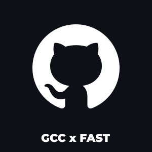

<div align="center">



# GitHub Campus Club · FAST-NUCES Karachi

The website and community arcade of the GitHub Campus Club at FAST-NUCES Karachi, built in the open by its members.

[](LICENSE)
[](https://nextjs.org)
[](https://react.dev)
[](CONTRIBUTING.md)

[Contributing](CONTRIBUTING.md) · [Arcade guide](games.md) · [Report a bug](https://github.com/GCC-FAST-NUCES-Karachi/GCC/issues/new) · [Design docs](docs/design.md)

</div>

---

## About

GCC is a student community for people who learn by building. This repository is the club's home on the web: what we do, upcoming events, the team, GitHub student perks, a small arcade of games made by members, and a simulated Git terminal with a hidden puzzle to find.

It is also a place to practise real open-source collaboration. Every page, game, and fix arrives through a reviewed pull request, and first-time contributors are welcome.

## What's inside

| Route | What it is |
| --- | --- |
| `/` | Landing page: what the club does, highlights, the arcade, upcoming events, and how to join |
| `/learn` | Beginner-friendly learning paths for Git, the web, and open source |
| `/events` | Upcoming and past events, with photo galleries for past sessions |
| `/team` | Faculty mentors, the executive committee, and the technical team |
| `/perks` | GitHub programs for students, such as the Student Developer Pack and Copilot |
| `/games` | The GCC Arcade hub |
| `/games/commit-snake` | Collect commits, dodge the GCC blocks, ship the release |
| `/games/bug-bash` | Squash bugs, spare working code, never force push |
| `/games/octo-dive` | A timed Git and GitHub quiz where every right answer dives deeper |
| `/terminal` | A simulated, read-only Git terminal with a hidden branch to unlock |

The terminal is a simulation. It never runs shell commands and never touches your files.

## Tech stack

- [Next.js 16](https://nextjs.org) (App Router) and [React 19](https://react.dev), written in plain JavaScript and JSX
- Plain CSS with shared design tokens in [`src/styles/tokens.css`](src/styles/tokens.css)
- Self-hosted [Inter](https://rsms.me/inter/) and [JetBrains Mono](https://www.jetbrains.com/lp/mono/) fonts
- [Lucide](https://lucide.dev) and [Simple Icons](https://simpleicons.org) for icons
- Deployed on [Vercel](https://vercel.com) with Vercel Analytics and Speed Insights

## Getting started

You need [Node.js](https://nodejs.org) 20.9 or newer (the current LTS is recommended) and npm.

```bash
git clone https://github.com/GCC-FAST-NUCES-Karachi/GCC.git
cd GCC
npm ci
npm run dev
```

Then open [http://localhost:3000](http://localhost:3000).

| Script | What it does |
| --- | --- |
| `npm run dev` | Start the development server with hot reload |
| `npm run lint` | Run ESLint |
| `npm run build` | Create a production build (this is what CI checks) |
| `npm run start` | Serve the production build locally |

No environment variables are needed to run the site locally.

## Project structure

```text
src/
├── app/                 Routes (App Router): one folder per page, with its own CSS
│   ├── games/           Arcade hub and one folder per game
│   ├── landing/         Sections of the landing page
│   └── terminal/        The /terminal route
├── components/
│   ├── effects/         Galaxy background, landing loop, and Easter egg effects
│   ├── events/          Event lists and cards shared by / and /events
│   ├── layout/          Navbar and footer
│   └── terminal/        Terminal overlay, command parser, and virtual repository
├── content/             Site content as plain data: events, team, games, links
├── lib/                 Small shared helpers
└── styles/tokens.css    Colours, fonts, and control styles
```

Most content changes, such as adding an event, a team member, or a game card, only touch a file in [`src/content/`](src/content).

## Contributing

Contributions of every size are welcome: a typo fix, a new page, a whole new game. The short version:

1. **Find something to work on.** Browse the [open issues](https://github.com/GCC-FAST-NUCES-Karachi/GCC/issues), or pick an item from the [open work list](CONTRIBUTING.md#open-work) in the contributing guide. For anything large, open an issue first so we can agree on the approach.
2. **Fork and branch.** Fork the repository, then create a branch from `main` named after the change, such as `feat/join-page` or `fix/event-dates`.
3. **Make the change and check it.** Run `npm run lint` and `npm run build`, and look at your change in the browser at desktop and phone widths.
4. **Open a pull request** against `main`. Describe what changed and why, and add screenshots for anything visual.

`main` is protected: every change is merged through a pull request that passes CI (lint and build) and is approved by a maintainer.

The full workflow, conventions, and the list of pages and features waiting for a contributor are in **[CONTRIBUTING.md](CONTRIBUTING.md)**. To add a game, start with the **[arcade guide](games.md)**.

## The people behind it

### Technical Head

<table>
  <tr>
    <td align="center" width="140"><a href="https://github.com/HunaBuilds"><br /><sub><b>Hunza Shahzadi</b></sub></a><br /><sub>Technical Head</sub></td>
  </tr>
</table>

### Development team

<table>
  <tr>
    <td align="center" width="140"><a href="https://github.com/ismailsilat7"><br /><sub><b>Ismail Silat</b></sub></a><br /><sub>Head</sub></td>
    <td align="center" width="140"><a href="https://github.com/Abdulrahman10724"><br /><sub><b>Abdul Rahman</b></sub></a><br /><sub>Co-Head</sub></td>
    <td align="center" width="140"><a href="https://github.com/Urwa5618"><br /><sub><b>Urwa Rafique</b></sub></a><br /><sub>Co-Head</sub></td>
    <td align="center" width="140"><a href="https://github.com/Hamza-04-mav"><br /><sub><b>Hamza Safdar</b></sub></a><br /><sub>Co-Head</sub></td>
  </tr>
</table>

### Product design team

<table>
  <tr>
    <td align="center" width="140"><a href="https://github.com/Zidarc"><br /><sub><b>Ali Hussain</b></sub></a><br /><sub>Head</sub></td>
    <td align="center" width="140"><a href="https://github.com/waniamuddasir"><br /><sub><b>Wania Muddasir</b></sub></a><br /><sub>Co-Head</sub></td>
    <td align="center" width="140"><a href="https://github.com/AyeshaNehal"><br /><sub><b>Ayesha Nehal</b></sub></a><br /><sub>Co-Head</sub></td>
  </tr>
</table>

### Contributors

<table>
  <tr>
    <td align="center" width="140"><a href="https://github.com/del-b2l"><br /><sub><b>Batool Kazmi</b></sub></a><br /><sub>Octo Dive</sub></td>
    <td align="center" width="140"><a href="https://github.com/maybethemuhammadibrahim"><br /><sub><b>Ibrahim</b></sub></a><br /><sub>Bug Bash</sub></td>
  </tr>
</table>

Contributors are listed here and on the website's `/team` page, which reads from [`src/content/contributors.js`](src/content/contributors.js). See [Credit for your work](CONTRIBUTING.md#credit-for-your-work) to add yourself.

## License

The source code is released under the [MIT License](LICENSE).

The GitHub Campus Club name and logos, team photos, and event posters in `public/` belong to the club and the people pictured. They are not covered by the MIT License and should not be reused outside this project without permission. The bundled Inter and JetBrains Mono fonts are distributed under the SIL Open Font License (see `public/fonts/`).

GitHub, the GitHub logo, and the Octocat are trademarks of GitHub, Inc. This is a student-run club project and is not an official GitHub product.
